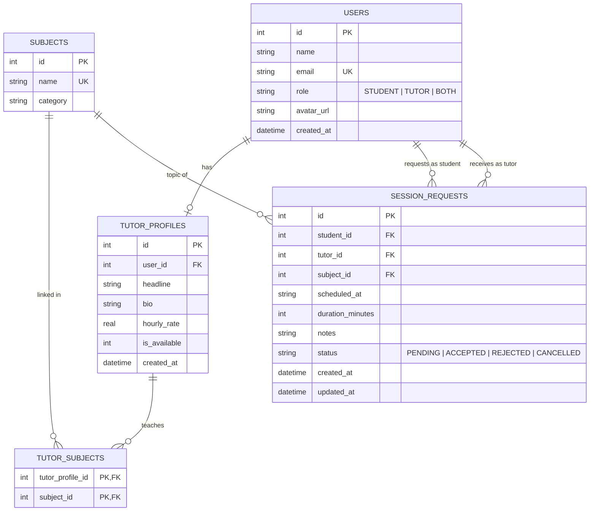

# 🎓 Online Peer Tutor Platform (Campus MVP)

A lightweight, robust, full-stack web application designed for college campuses where students can discover peer tutors by subject, book 1-on-1 tutoring sessions, and tutors can manage incoming requests and customize their profile offerings.

---

## 📌 Architecture Overview

```mermaid
flowchart TD
    subgraph Client["Frontend: React 18 + Vite + Tailwind CSS"]
        Navbar["Navbar & Demo Persona Switcher"]
        Browse["Browse Tutors (Filters & Search)"]
        Modal["Booking Request Modal"]
        Bookings["Bookings Dashboard (Accept / Decline)"]
        Profile["Tutor Profile Editor"]
    end

    subgraph Server["Backend: Node.js + Express.js"]
        Router["Express REST Endpoints (/api)"]
        Validate["Input Validation & Auth Middlewares"]
        Controllers["Controllers: Users, Subjects, Tutors, Sessions"]
    end

    subgraph Database["Database: SQLite (Native node:sqlite)"]
        DB[("peer_tutor.db")]
        Tables["users | subjects | tutor_profiles | tutor_subjects | session_requests"]
    end

    Client -->|HTTP / JSON (Vite Proxy)| Server
    Server -->|Direct SQL / Foreign Keys| Database
```

---

## 🛠️ Technology Stack & Design Decisions

| Layer | Technology | Why Chosen for Hackathon & College Evaluation |
|---|---|---|
| **Frontend** | React 18, Vite, Tailwind CSS, Lucide Icons | Instant hot-reloading (HMR), component-driven UI, responsive badges, loading skeletons, and interactive state management. |
| **Backend** | Node.js, Express.js | Industry standard, modular routing (`routes/` + `controllers/`), clean async error handling. |
| **Database** | SQLite via **native `node:sqlite`** | **Zero external setup**: runs right inside Node v24 with no Docker, no external background service, and no native C++ compilation headaches. Uses standard SQL with foreign keys and relational constraints. |
| **Demo UX** | Persona Switcher | Allows hackathon judges to instantly switch between student and tutor roles in the header without tedious registration and re-login steps. |

---

## 🗄️ Relational Database Schema



---

## 🚀 Quick Start Guide

### Prerequisites
- **Node.js**: v22+ or v24+ (uses built-in `node:sqlite`)
- **npm**: v10+

### 1. Installation
Install server and client packages:

```bash
# In the project root:
cd server && npm install
cd ../client && npm install
cd ..
```

### 2. Seed Database
Initialize schema and seed realistic students, tutors, subjects, and sample sessions:

```bash
npm run seed
```

### 3. Run Automated Tests
Verify database integrity, REST APIs, and end-to-end booking flow:

```bash
npm test
```
*(Runs schema integrity check, 10-step REST API flow test, frontend-backend integration test, and Vite production bundle build).*

### 4. Start the Application
Open two terminal windows (or run commands):

**Terminal 1 (Backend API):**
```bash
npm run server
# Server will run at http://localhost:5000
```

**Terminal 2 (Frontend Client):**
```bash
npm run client
# Client will run at http://localhost:3000
```

Visit **`http://localhost:3000`** in your browser.

---

## 🔄 End-to-End User Journey Demo

1. **Browse Tutors as a Student**:
   - In the top-right header, ensure the demo persona is set to **Alex Rivera (Student)**.
   - Click on subject chips like **"Data Structures & Algorithms"** or **"Linear Algebra"** to filter tutors.
   - Type in the search box to find tutors by keywords.
2. **Request a Tutoring Session**:
   - Click **"Request Session"** on David Miller's tutor card.
   - Select the topic, pick a date & time, duration (e.g. 60 mins), and add a note: *"Need help with Dynamic Programming recursion"*.
   - Click **"Send Request"**. You will automatically be routed to **"My Bookings"** showing your request with an amber **`Pending Confirmation`** badge.
3. **Switch to Tutor & Accept the Session**:
   - In the top-right header, switch persona to **David Miller (Tutor)**.
   - Notice the amber badge on the **Bookings** tab indicating incoming requests.
   - Click on **"Incoming Requests (as Tutor)"**.
   - Review Alex's request note and click **"Accept"**.
   - The status updates instantly to **`Session Confirmed`** (green badge).
4. **Confirm as Student**:
   - Switch persona back to **Alex Rivera (Student)**.
   - Navigate to **"My Bookings"**; the request is now verified as **`Session Confirmed`**!

---

## 📡 REST API Reference

| Method | Endpoint | Description |
|---|---|---|
| `GET` | `/api/health` | Health check endpoint |
| `GET` | `/api/users` | List demo personas with avatars and roles |
| `GET` | `/api/users/:id` | Get user details and linked tutor profile |
| `POST` | `/api/users` | Register a new student or tutor |
| `GET` | `/api/subjects` | List academic subjects with tutor counts |
| `GET` | `/api/tutors?subjectId=&search=` | Browse available tutors with dynamic filters |
| `GET` | `/api/tutors/:id` | Get detailed tutor profile and taught subjects |
| `POST` | `/api/tutors/profile` | Create/update tutor profile & taught subjects |
| `GET` | `/api/sessions?userId=&asRole=` | Retrieve sessions for student or tutor role |
| `POST` | `/api/sessions` | Create a new session request (`status: PENDING`) |
| `PATCH` | `/api/sessions/:id/status` | Update booking status (`ACCEPTED`, `REJECTED`, `CANCELLED`) |

---
